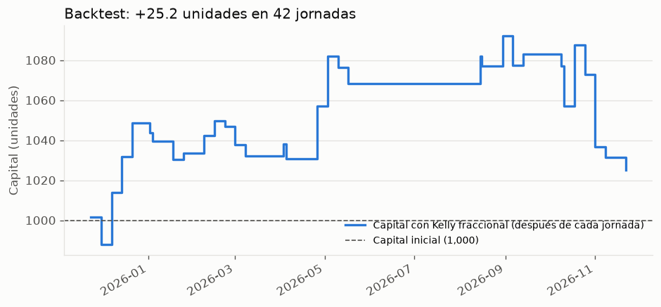

# Resultados del modelo

**Versión vigente:** [modelo-20261124-1320](https://github.com/LuisBellocs/on-sports-betting/releases/tag/modelo-20261124-1320)  
**Entrenado:** 2026-11-24 13:20 · **Datos hasta:** 2026-11-23 · **Partidos:** 1209 · **Métrica de forma:** xg

Descarga el modelo de esta versión, o de cualquier versión anterior, en la página de [versiones](https://github.com/LuisBellocs/on-sports-betting/releases).

## En pocas palabras

- **Over 2.5 contra el cierre del mercado:** sin diferencia significativa (log-loss 0.6752 contra 0.6656, p = 0.066).
- **1X2 contra el cierre del mercado:** el mercado es mejor (log-loss 0.9769 contra 0.9537, p < 0.001).
- **Sesgo del over 2.5 en prueba:** el modelo esperaba 51.4% y ocurrió 52.5%.
- **Contra la versión anterior (modelo-20261109-2156):** log-loss over 2.5 mejoró (-0.0021).
- **Estrategia de apuestas en el periodo de prueba:** 80 apuestas, ganancia +25.2 unidades sobre un bankroll de 1,000 (rendimiento 5.1% sobre lo apostado, CLV 0.8%). **Todavía no es estadísticamente significativa** (p = 0.62): con estos datos aún puede ser suerte. [Ver el backtest](historial/backtest/backtest.md).
- **Consenso entre modelos:** RegresionPoisson + DixonColes + GradientBoosting + Bayesiano — alerta SIN_CONSENSO.

Todas las métricas se miden en el 30 % más reciente de los partidos, reentrenando jornada a jornada. Más bajo es mejor.

## Métricas por modelo

| Modelo | Log-loss marcador | Log-loss over 2.5 | Brier over 2.5 | Log-loss 1X2 | RPS 1X2 |
|---|---|---|---|---|---|
| DixonColes | 2.8788 | 0.6837 | 0.2452 | 0.9759 | 0.2013 |
| RegresionPoisson | 2.8697 | 0.6792 | 0.2435 | 0.9830 | 0.2033 |
| GradientBoosting | 2.8979 | 0.6907 | 0.2484 | 0.9910 | 0.2046 |
| Bayesiano | 2.8775 | 0.6818 | 0.2442 | 0.9932 | 0.2040 |
| Ensamble | 2.8561 | 0.6752 | 0.2413 | 0.9769 | 0.2002 |
| Base (promedio liga) | 2.9770 | 0.6958 | 0.2513 | 1.0554 | 0.2259 |
| Mercado apertura |  | 0.6689 | 0.2384 | 0.9581 | 0.1954 |
| Mercado cierre |  | 0.6656 | 0.2370 | 0.9537 | 0.1939 |

## Ensamble contra el mercado (mismos partidos)

| Mercado | Métrica | Partidos | Ensamble | Mercado | Diferencia | p (Wilcoxon) | Veredicto |
|---|---|---|---|---|---|---|---|
| Mercado apertura | Log-loss over 2.5 | 381 | 0.6752 | 0.6689 | +0.0063 | 0.399 | sin diferencia significativa |
| Mercado apertura | Brier over 2.5 | 381 | 0.2413 | 0.2384 | +0.0028 | 0.459 | sin diferencia significativa |
| Mercado apertura | Log-loss 1X2 | 381 | 0.9769 | 0.9581 | +0.0188 | < 0.001 | el mercado es mejor |
| Mercado apertura | RPS 1X2 | 381 | 0.2002 | 0.1954 | +0.0048 | < 0.001 | el mercado es mejor |
| Mercado cierre | Log-loss over 2.5 | 381 | 0.6752 | 0.6656 | +0.0096 | 0.066 | sin diferencia significativa |
| Mercado cierre | Brier over 2.5 | 381 | 0.2413 | 0.2370 | +0.0043 | 0.087 | sin diferencia significativa |
| Mercado cierre | Log-loss 1X2 | 381 | 0.9769 | 0.9537 | +0.0232 | < 0.001 | el mercado es mejor |
| Mercado cierre | RPS 1X2 | 381 | 0.2002 | 0.1939 | +0.0063 | < 0.001 | el mercado es mejor |

## Estrategia de apuestas (backtest)

Simulación jornada a jornada del portafolio en el periodo de prueba (2025-11-23 a 2026-11-23), con cuotas de apertura y peso del modelo 0.3.

| Apuestas | Aciertos | Ganancia | Rendimiento | Caída máxima | CLV medio | P(terminar en ganancia) |
|---|---|---|---|---|---|---|
| 80 | 28.7% | +25.2 | 5.1% | 6.1% | 0.8% | 62.9% |

Detalle, sensibilidad al peso del modelo y todas las apuestas: [historial/backtest/backtest.md](historial/backtest/backtest.md).

## Calibrador de goles

Factor que multiplica los goles esperados de cada modelo (1 = sin corrección).

| DixonColes | RegresionPoisson | GradientBoosting | Bayesiano |
|---|---|---|---|
| 1.027 | 0.991 | 1.050 | 1.046 |

## Calibración del over 2.5 (ensamble)

| Tramo | Partidos | Probabilidad media | Frecuencia real |
|---|---|---|---|
| (0.25, 0.3] | 1 | 28.3% | 100.0% |
| (0.3, 0.35] | 10 | 32.7% | 20.0% |
| (0.35, 0.4] | 31 | 37.4% | 32.3% |
| (0.4, 0.45] | 57 | 42.7% | 52.6% |
| (0.45, 0.5] | 83 | 47.7% | 48.2% |
| (0.5, 0.55] | 76 | 52.3% | 53.9% |
| (0.55, 0.6] | 55 | 56.9% | 52.7% |
| (0.6, 0.65] | 32 | 62.1% | 65.6% |
| (0.65, 0.7] | 16 | 67.4% | 75.0% |
| (0.7, 0.75] | 13 | 72.8% | 69.2% |
| (0.75, 0.8] | 5 | 77.7% | 60.0% |
| (0.8, 0.85] | 2 | 83.9% | 100.0% |

## Aciertos del over/under 2.5 en predicciones reales

Cada partido predicho suma un punto si el modelo acertó: over cuando dijo más de 50 % y hubo 3 o más goles, o under en cualquier otro caso. Los resultados salen de `datos/`. Detalle partido a partido: [historial/aciertos_over25.csv](historial/aciertos_over25.csv).

## Historial de versiones

| Versión | Entrenado | Datos hasta | Partidos | Log-loss marcador | Log-loss over 2.5 | Cierre over 2.5 | Log-loss 1X2 | Over 2.5 esperado / real |
|---|---|---|---|---|---|---|---|---|
| [modelo-20261124-1320](https://github.com/LuisBellocs/on-sports-betting/releases/tag/modelo-20261124-1320) | 2026-11-24 13:20 | 2026-11-23 | 1209 | 2.8561 | 0.6752 | 0.6656 | 0.9769 | 51.4% / 52.5% |
| [modelo-20261109-2156](https://github.com/LuisBellocs/on-sports-betting/releases/tag/modelo-20261109-2156) | 2026-11-09 21:56 | 2026-11-08 | 1199 | 2.8546 | 0.6773 | 0.6662 | 0.9784 | 51.4% / 52.4% |
