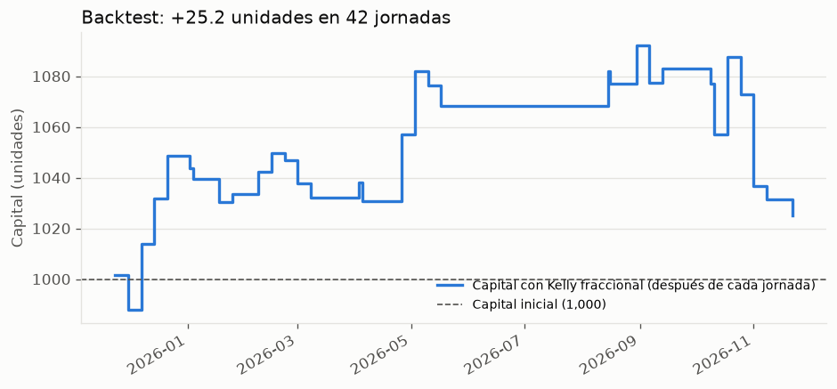

# Backtest de la estrategia de apuestas

Periodo: **2025-11-23 a 2026-11-23** (42 jornadas, 381 partidos). Cada jornada se predijo con el modelo reentrenado solo con partidos anteriores, y se apostó con las **cuotas de apertura** promedio del mercado (las disponibles días antes del partido).

Reglas: bankroll inicial 1,000, Kelly 0.25, VE mínimo 3%, peso del modelo 0.3, máximo 5% por apuesta y 25% por jornada, cuotas entre 1.3 y 6.0. El filtro del intervalo no se aplica aquí (no hay remuestreos guardados del periodo de prueba), así que el backtest es algo más permisivo que el portafolio real.

## Resultado con Kelly fraccional

| Medida | Valor |
|---|---|
| Apuestas | 80 |
| Aciertos | 28.7% |
| Total apostado | 496.38 |
| **Ganancia** | **+25.24** (capital final 1,025.24) |
| Rendimiento sobre lo apostado (yield) | +5.1% |
| Caída máxima desde un pico (drawdown) | 6.1% |
| Probabilidad de terminar en ganancia (remuestreo de jornadas) | 62.9% |
| CLV medio (cuota tomada contra cuota de cierre) | +0.8% |
| Apuestas con mejor cuota que el cierre | 46.2% |

El **CLV** es la mejor señal de habilidad a largo plazo: si las cuotas que tomas suelen ser mejores que las de cierre, el mercado terminó moviéndose hacia tu predicción.

## ¿Existe algún umbral de VE rentable? (apuesta fija de 1 unidad)

| VE mínimo | Apuestas | Aciertos | Rendimiento por apuesta | Ganancia (unidades) | p-valor (rendimiento > 0) |
|---|---|---|---|---|---|
| 0% | 740 | 38.8% | -9.1% | -67.3 | 0.979 |
| 2% | 626 | 38.0% | -9.0% | -56.2 | 0.966 |
| 5% | 478 | 37.4% | -6.5% | -31.1 | 0.866 |
| 10% | 306 | 35.3% | -3.6% | -11.1 | 0.678 |
| 15% | 200 | 32.5% | -8.6% | -17.1 | 0.807 |

Un p-valor menor a 0.05 indicaría que la ganancia probablemente no es suerte. Si ningún umbral lo logra, la estrategia todavía no ha demostrado ventaja sobre el mercado.

## ¿Cuánto confiar en el modelo frente al mercado? (apuesta fija, VE usado ≥ 3%)

VE usado = peso × VE del modelo + (1 − peso) × VE según el mercado. Un peso bajo solo apuesta cuando el modelo discrepa del mercado de forma marcada.

| Peso del modelo | Apuestas | Aciertos | Rendimiento por apuesta | Ganancia (unidades) | p-valor |
|---|---|---|---|---|---|
| 1 | 572 | 37.9% | -7.9% | -45.1 | 0.935 |
| 0.5 | 250 | 33.6% | -6.7% | -16.7 | 0.776 |
| 0.3 (actual) | 82 | 29.3% | -5.2% | -4.2 | 0.616 |
| 0.2 | 20 | 40.0% | +36.5% | +7.3 | 0.179 |
| 0.1 | 0 | | | | |

Cuidado: elegir el peso mirando esta tabla es ajustar al pasado; trátala como orientación, no como prueba de ventaja.

## Por mercado

| Mercado | Apuestas | Apostado | Ganancia |
|---|---|---|---|
| 1X2 | 51 | 254.12 | +23.78 |
| Hándicap asiático | 11 | 131.23 | -7.46 |
| Over/Under 2.5 | 18 | 111.03 | +8.93 |

Limitación: los pesos del ensamble se eligieron con este mismo periodo de prueba; como son casi iguales entre modelos, el efecto es pequeño, pero el resultado real puede ser algo peor.
