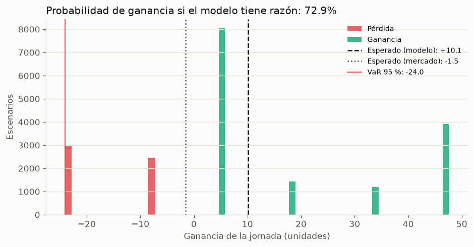

# Portafolio de la jornada

Bankroll: **1,000** · Kelly: **0.25** · VE mínimo: **3%** · Máximo por apuesta: **5%** · Máximo en la jornada: **25%** · Intervalo exigido: **sí** · Peso del modelo frente al mercado: **0.3**

## Apuestas

| Partido | Fecha | Mercado | Selección | Cuota | P(ganar) | VE usado (IC 90 %) | VE modelo | VE mercado | % bankroll | Monto |
|---|---|---|---|---|---|---|---|---|---|---|
| Betis vs Vallecano | 2026-11-28 | 1X2 | **Visitante** | 5.02 | 32.8% | +15.0% (+4.6% a +27.8%) | +64.8% | -6.3% | 0.85% | 8.48 |
| La Coruna vs Barcelona | 2026-11-29 | Hándicap asiático | **La Coruna +2** | 1.87 | 59.8% | +4.6% (+0.0% a +8.0%) | +30.4% | -6.5% | 1.55% | 15.53 |

## Riesgo del portafolio (simulación Monte Carlo)

Simulados 20,000 escenarios con las matrices de marcadores del modelo; las apuestas de un mismo partido se simulan juntas, así que su correlación está incluida.

| Medida | Valor |
|---|---|
| Total apostado | 24.01 (2.4% del bankroll) |
| Ganancia esperada si el modelo tiene razón | +10.09 |
| Ganancia esperada con la mezcla modelo/mercado | +1.98 |
| **Ganancia esperada si el mercado tiene razón** | **-1.54** |
| Probabilidad de terminar la jornada en ganancia (si el modelo tiene razón) | 72.9% |
| Probabilidad de perder más del 10 % del bankroll | 0.0% |
| Resultado mediano | +5.03 |
| Rango del 90 % | -24.01 a +47.60 |
| VaR 95 % (pérdida que solo se supera 1 de cada 20 jornadas) | 24.01 |
| CVaR 95 % (pérdida promedio en esa peor 5 %) | 24.01 |
| Peor caso simulado | -24.01 |

La fila *si el mercado tiene razón* usa las probabilidades implícitas de las cuotas sin margen. Si es negativa, la ganancia depende por completo de que el modelo sepa más que el mercado; revisa en `historial/backtest/backtest.md` si eso se ha cumplido en el pasado.

## Mejores apuestas descartadas

| Partido | Selección | Cuota | VE | Motivo |
|---|---|---|---|---|
| Real Madrid vs Alaves | Visitante | 17.16 | +25.2% | cuota fuera de [1.3, 6.0] |
| La Coruna vs Barcelona | Local | 9.80 | +17.7% | cuota fuera de [1.3, 6.0] |
| Elche vs Ath Madrid | Local | 6.20 | +11.2% | cuota fuera de [1.3, 6.0] |
| Real Madrid vs Alaves | Empate | 9.19 | +10.5% | cuota fuera de [1.3, 6.0] |
| La Coruna vs Barcelona | Empate | 7.12 | +7.4% | cuota fuera de [1.3, 6.0] |
| La Coruna vs Barcelona | Under 2.5 | 3.91 | +6.8% | VE no es positivo en todo el intervalo del modelo |
| Real Madrid vs Alaves | Alaves +2.5 | 1.78 | +2.1% | VE menor a 3% |
| Betis vs Vallecano | Vallecano +1 | 1.81 | +1.9% | VE menor a 3% |

Para cambiar el bankroll o los criterios, edita `portafolio.json` en la raíz del repositorio.
